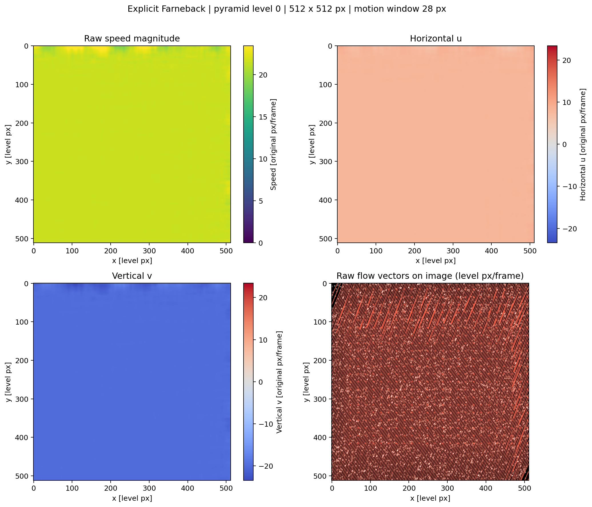
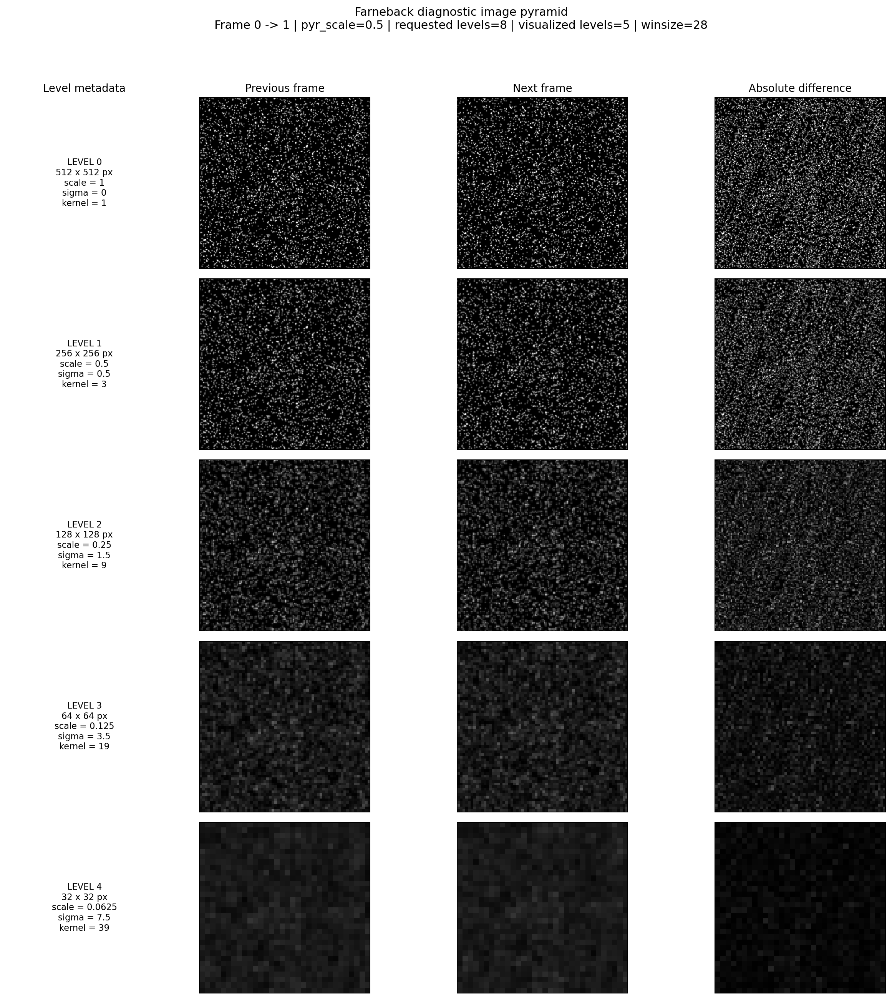
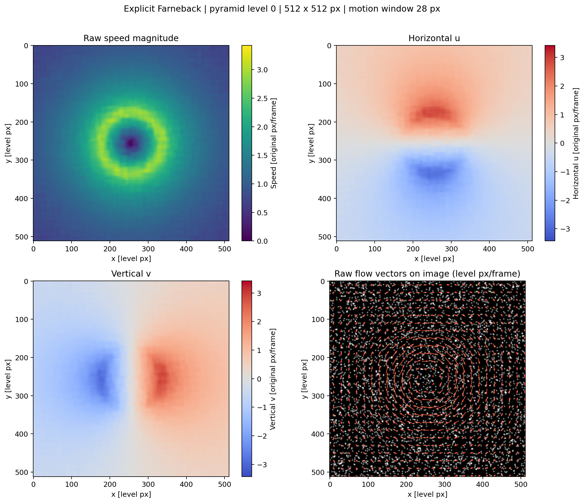
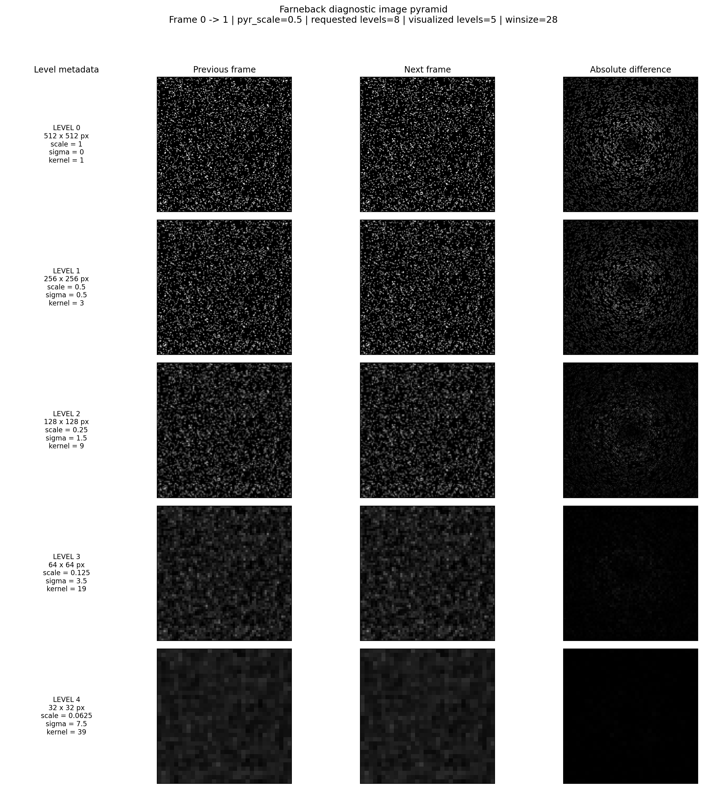
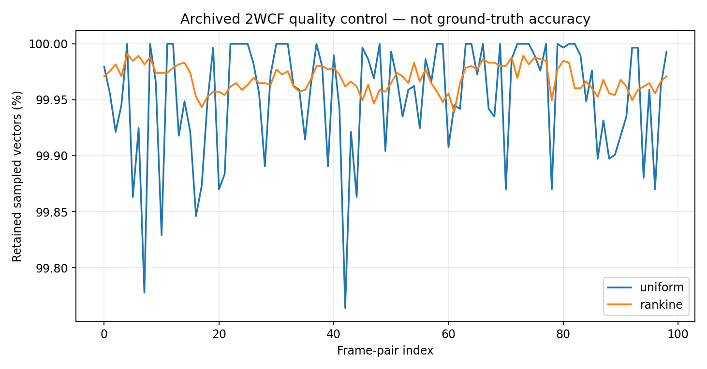
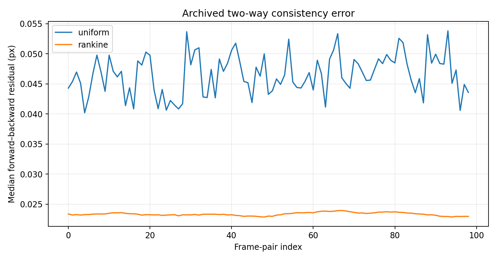
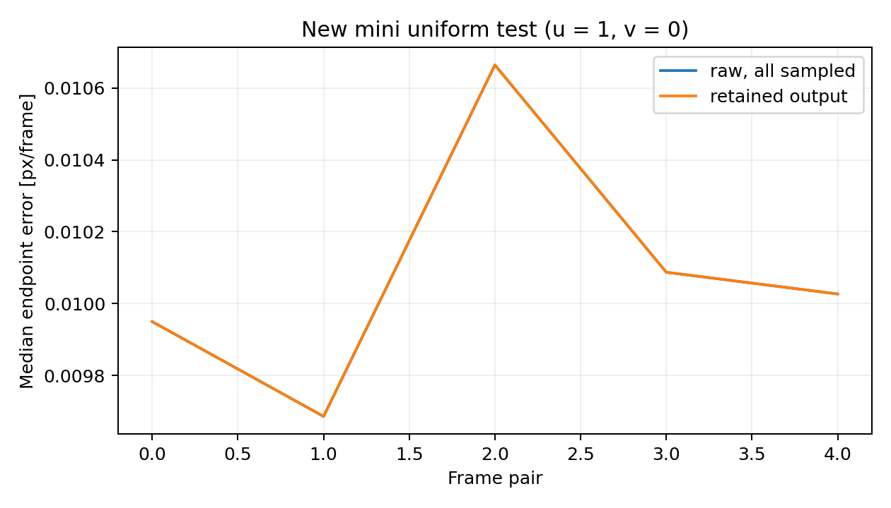

# Examples with archived visuals

The figures below are **original outputs extracted from the user-supplied benchmark archives**, or plots reconstructed from their `flow_qc_metrics.csv`; no new ground-truth analysis is implied.

## Historical uniform translation — `synthetic_uniform_u8_vm20_run_55`

The original archive contains 99 validation NPZ files, 99 PKL vector fields, 99 WXF fields, one MP4, pyramid/flow diagnostics, and QC records. In its `parameters.json`, `USE_SVD=false`, `ArrowDensityStep=3`, `WindowSize=28`, `IterationCount=5`, `PolyFitKernelSize=7`, `GaussKernelStdev=1`, `PyramidDownsampleFactor=0.5`, `PyramidLevels=8`, `UseInformationAwareSolver=true`, `InformationRidgeFraction=0.5`, `InformationPriorWindow=3`, and hard-mask mode (`UseConfidenceSmoothing=false`). No `FarnebackWarpMode` is recorded.

The **QC log** over 99 frame pairs has median retention **99.966%** and median forward/backward residual **0.04663 px**. In the first saved sampled field, median retained `(u,v)` is approximately `(8.0006,-20.0005)` px/frame. These are observational QC/flow values; without the separately generated ground-truth field and input TIFFs, **no independent EPE claim is made**.



*Image: original archived level-0 explicit flow diagnostic (not 2WCF-filtered output).* 



*Image: original archived image-pyramid contact sheet.*

## Historical Rankine vortex — `synthetic_rankine_R80_vb3_cx255p5_cy255p5_run_11`

The archive includes 99 validation NPZ, PKL and WXF pair outputs, with analogous diagnostic figures. Its recorded warp mode is **`frame2_polynomial`**, with additional refinement settings absent from the modular ZIP; this run is **not directly reproducible** with the latest refactor. Recorded settings include `ArrowDensityStep=2`, `WindowSize=28`, `IterationCount=5`, `PolyFitKernelSize=7`, `GaussKernelStdev=1`, information ridge fraction 0.5 and spatial prior window 3. `USE_SVD=false`.

The QC log over 99 frame pairs has median retention **99.968%** and median forward/backward residual **0.02333 px**. These measurements are **not** independent proof of Rankine flow accuracy or of superior regularization.



*Image: original archived level-0 explicit solver diagnostic.*



## QC comparison (data-derived, not an accuracy comparison)





The curves are from **different flows with different sampling grids and solver modes**. Do not interpret their differences as evidence that one algorithmic configuration is better.

## Runnable portable mini example (new)

Run the following from the package root:

```bash
python benchmarks/generators/generate_mini_uniform.py
python run.py --config examples/mini_uniform_config.json
python benchmarks/evaluators/evaluate_mini_uniform.py
```

The generator writes six 128×128 TIFFs and matching uniform ground truth with a fixed seed. This is **not** one of the supplied 99-pair historical benchmarks. The pipeline writes five pairs to `output/mini_uniform_run_1/`. The portable `evaluate_mini_uniform.py` script compares the resulting vectors with the included ground truth and writes `output/mini_uniform_run_1/mini_validation/mini_uniform_metrics.csv` and `mini_epe.png`. The separate historical evaluators retain their original hard-coded Windows paths. Example config intentionally disables optional WXF export, expensive diagnostics, and MP4 video.

## Missing pieces for exact historical reproduction

For either historical case, supply the **original input TIFF sequence**, its **ground-truth NPZ**, and the **exact source revision**. For the Rankine case, also supply the historical solver implementing `frame2_polynomial`, plus its matching Rankine generator. The two `.7z` archives are preserved separately, not rewritten as new modular results.

### Observed demo accuracy (not the historical archive)



This figure is generated by `benchmarks/evaluators/evaluate_mini_uniform.py` from the **newly generated** `u=1, v=0` ground truth and its five processed pairs. On this local demonstration, median retained EPE across the five pairs was approximately **0.0100 px/frame**, and all sampled vectors were retained. The raw and retained curves overlap because hard mode was used and there were no rejected samples. The evaluator reports errors at the sampled candidate grid and retains output EPE only where the consistency mask passes. The CSV and original first-pair validation NPZ are included under `results/examples/mini_uniform_run_1/`. Do not confuse these values with the original 99-pair u8/v−20 data.
