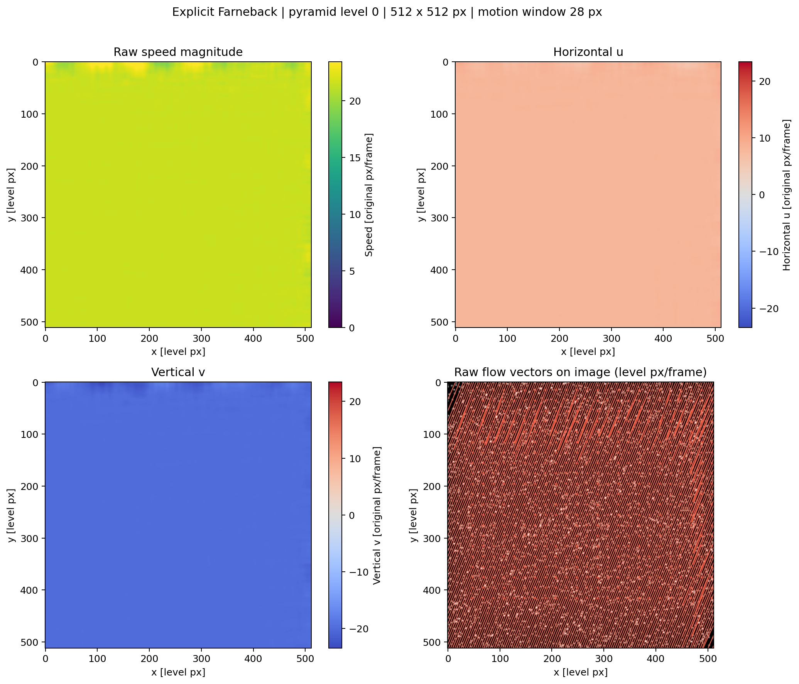
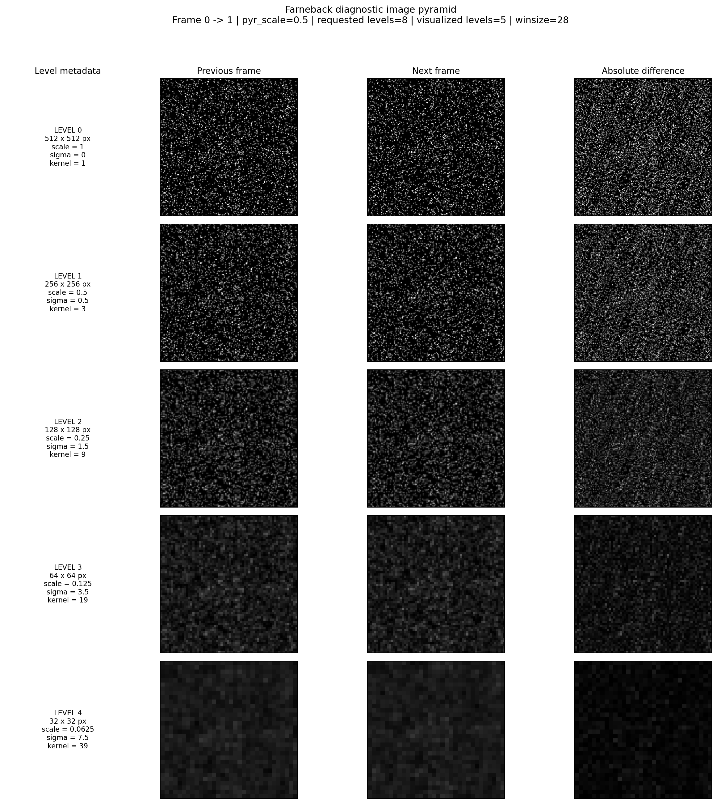
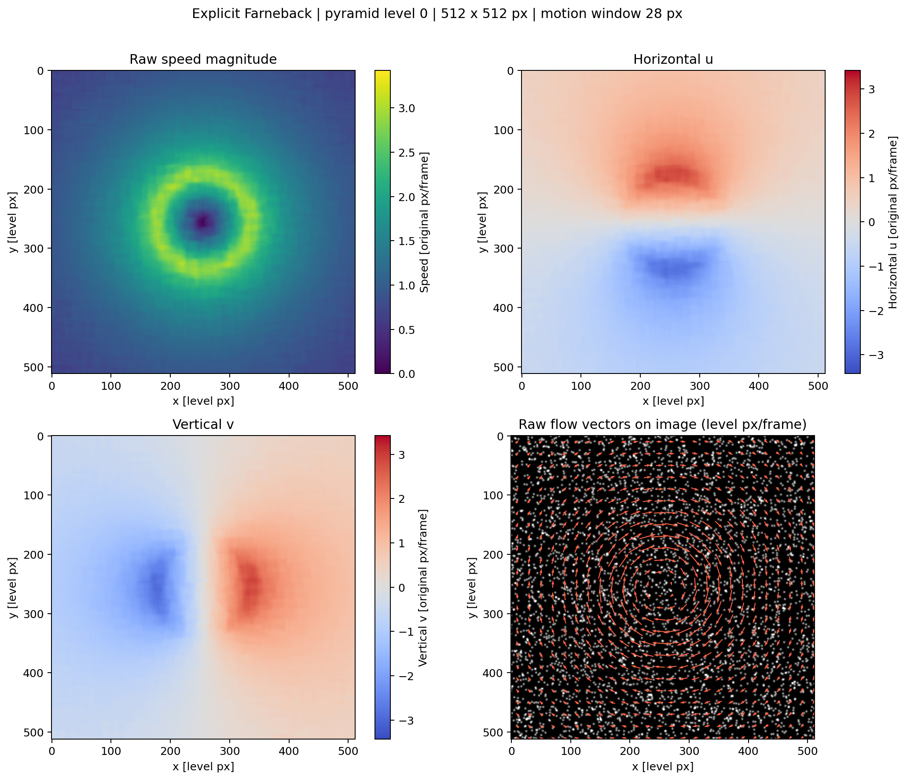
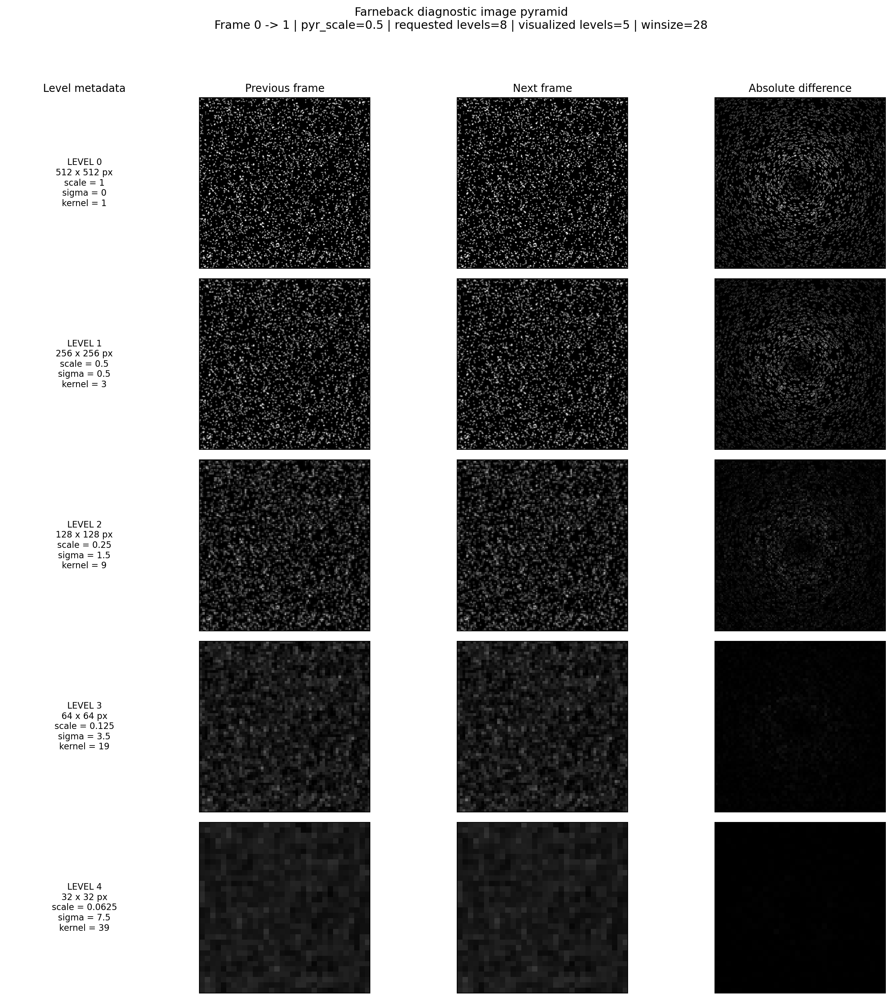
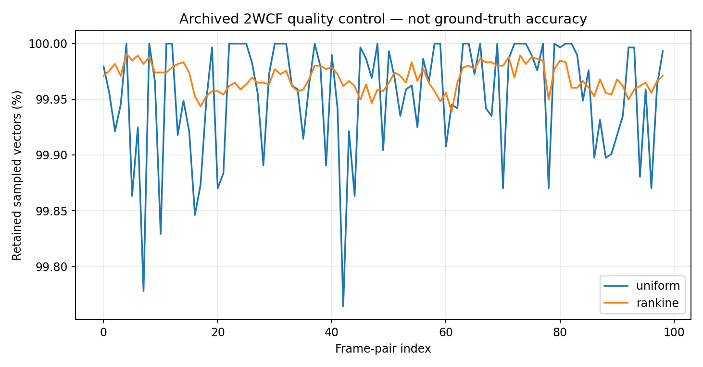
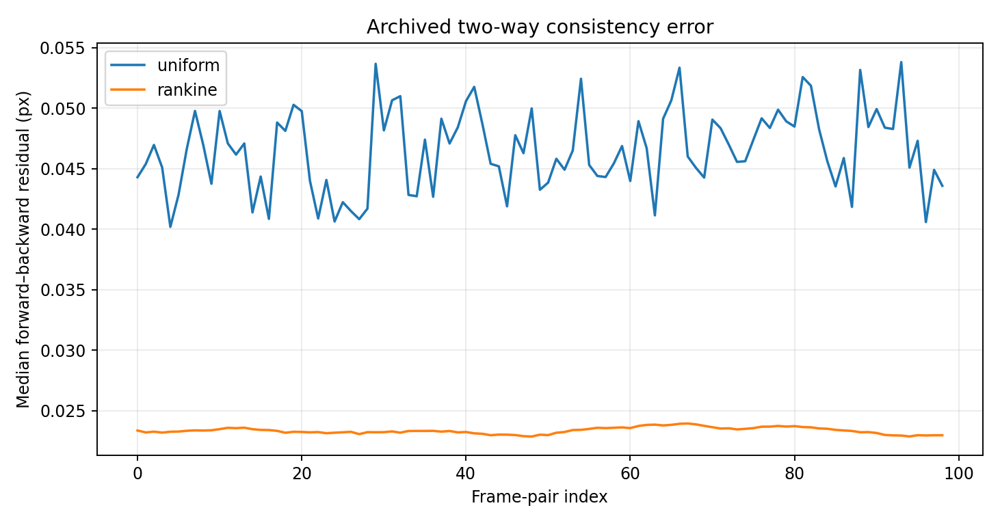

# Examples with archived visuals

*Historical record. Describes two archived 99-pair synthetic runs made with earlier solver versions; reviewed 24 November 2026. For the current method see [`methods.md`](../methods.md).*

The figures below are **original outputs extracted from the two benchmark archives**, or plots reconstructed from their `flow_qc_metrics.csv`; no new ground-truth analysis is implied.

## Historical uniform translation — `synthetic_uniform_u8_vm20_run_55`

The original archive contains 99 validation NPZ files, 99 PKL vector fields, 99 WXF fields, one MP4, pyramid/flow diagnostics, and QC records. In its `parameters.json`, `USE_SVD=false`, `ArrowDensityStep=3`, `WindowSize=28`, `IterationCount=5`, `PolyFitKernelSize=7`, `GaussKernelStdev=1`, `PyramidDownsampleFactor=0.5`, `PyramidLevels=8`, `UseInformationAwareSolver=true`, `InformationRidgeFraction=0.5`, `InformationPriorWindow=3`, and hard-mask mode (`UseConfidenceSmoothing=false`). No `FarnebackWarpMode` is recorded.

The **QC log** over 99 frame pairs has median retention **99.966%** and median forward/backward residual **0.04663 px**. In the first saved sampled field, median retained `(u,v)` is approximately `(8.0006,-20.0005)` px/frame. These are observational QC/flow values; without the separately generated ground-truth field and input TIFFs, **no independent EPE claim is made**.

*Image: original archived level-0 explicit flow diagnostic (not 2WCF-filtered output).* 

*Image: original archived image-pyramid contact sheet.*

## Historical Rankine vortex — `synthetic_rankine_R80_vb3_cx255p5_cy255p5_run_11`

The archive includes 99 validation NPZ, PKL and WXF pair outputs, with analogous diagnostic figures. Its recorded warp mode is **`frame2_polynomial`**, with additional refinement settings that the current solver does not have; this run is **not directly reproducible** with the latest refactor. Recorded settings include `ArrowDensityStep=2`, `WindowSize=28`, `IterationCount=5`, `PolyFitKernelSize=7`, `GaussKernelStdev=1`, information ridge fraction 0.5 and spatial prior window 3. `USE_SVD=false`.

The QC log over 99 frame pairs has median retention **99.968%** and median forward/backward residual **0.02333 px**. These measurements are **not** independent proof of Rankine flow accuracy or of superior regularization.

*Image: original archived level-0 explicit solver diagnostic.*

## QC comparison (data-derived, not an accuracy comparison)

The curves are from **different flows with different sampling grids and solver modes**. Do not interpret their differences as evidence that one algorithmic configuration is better.

## Missing pieces for exact historical reproduction

Exact reproduction of either case needs the **original input TIFF sequence**, its **ground-truth NPZ** and the **exact source revision**. The Rankine case also needs the historical solver implementing `frame2_polynomial`, plus its matching Rankine generator. The two `.7z` archives are preserved separately, not rewritten as new modular results.
